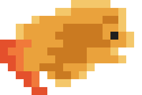

<p align="center"></p>

# Crusty-Claude

[](https://github.com/T-Celor/crusty-claude/actions/workflows/ci.yml)

Agent de développement en Rust pour le terminal, inspiré de Claude Code : **multi-fournisseur**,
**multi-agent** (l'agent principal est *toujours* un orchestrateur qui délègue à des exécuteurs
spécialisés, chacun avec son modèle), **optimisé en tokens** (RTK, HTML→Markdown, Graphify,
Headroom, Context Gate, pxpipe et la politique Ponytail, tous natifs en Rust) et **visible** :
une TUI complète affiche en temps réel ce que fait chaque agent et ce que chaque optimiseur
fait gagner.

> **État du projet (v0.2) — à lire.** Tout ce qui est décrit ici est implémenté, compilé et couvert par
> des tests automatisés. En revanche, **aucun
> appel réel à l'API Anthropic ou OpenAI n'a été effectué pendant le développement** (pas de clé) :
> les fournisseurs sont testés contre des serveurs simulés reproduisant le protocole (SSE, outils,
> erreurs, reprises). Les gains de tokens sont **mesurés** quand le fournisseur offre `count_tokens`
> (activé par défaut) et restent des **estimations** (4 caractères ≈ 1 token) sinon. Les limites
> restantes sont listées dans [Limites](#limites), sans détour.

---

## Sommaire

- [Ce que fait Crusty-Claude](#ce-que-fait-crusty-claude)
- [Installation](#installation)
- [Démarrage rapide](#démarrage-rapide)
- [L'interface (TUI)](#linterface-tui)
- [Orchestrateur, exécuteurs et modèles par domaine](#orchestrateur-exécuteurs-et-modèles-par-domaine)
- [Le pipeline d'optimisation](#le-pipeline-doptimisation)
- [Proxies d'économie de tokens (agnostiques)](#proxies-déconomie-de-tokens-agnostiques)
- [Permissions et sécurité](#permissions-et-sécurité)
- [Sandbox des commandes](#sandbox-des-commandes)
- [Laya : décisions locales](#laya--décisions-locales)
- [Checkpoints et /rewind](#checkpoints-et-rewind)
- [Skills et plugins](#skills-et-plugins)
- [Intégration éditeurs (ACP)](#intégration-éditeurs-acp)
- [Commandes slash](#commandes-slash)
- [Ligne de commande](#ligne-de-commande)
- [Compatibilité Claude Code](#compatibilité-claude-code)
- [Limites](#limites)
- [Développement](#développement)
- [Licence et crédits](#licence-et-crédits)

## Ce que fait Crusty-Claude

```
TUI (ratatui)  ──UiCommand──▶  Contrôleur de session  ──▶  Orchestrateur (toujours)
   ▲                                                         │  Task(domaine, prompt)
   │ AppEvent (typés, temps réel)                            ▼
   └──────── métriques ◀──────────────────────────────  Exécuteurs : coder, reviewer, tester,
                                                         designer, graphiste, architect, security,
                                                         web_researcher, documentation, scout
                                                             │
                     outils ◀── moteur de permissions ◀──────┤   (Read/Write/Edit/Glob/Grep/LS,
                     (sandbox, risques, approbations)        │    Bash, WebFetch/WebSearch, Graph,
                                                             │    TodoWrite, Retrieve, MCP…)
                                                             ▼
    sorties d'outils ─▶ RTK · HTML→Markdown            requête modèle ─▶ Headroom ─▶ Context Gate
                                                                          (fonction de gain) ─▶ pxpipe
                                                             ▼
                                Fournisseurs : Anthropic · OpenAI-compatibles (OpenAI, OpenRouter,
                                Gemini, Ollama, vLLM…) · Bedrock · Vertex AI · mock hors ligne
                                — via proxies optionnels
```

- **Orchestrateur/exécuteur imposé** : l'orchestrateur ne dispose que d'outils de lecture, de
  `TodoWrite` et de `Task` ; toute modification passe par un exécuteur. Délégations parallèles,
  boucles de revue limitées, profondeur limitée, budgets en tokens et en dollars par agent.
- **Modèle par domaine** : chaque domaine (codeur, designer, graphiste, reviewer…) a son
  fournisseur, son modèle, son effort, ses outils et ses modèles de repli ; modifiable dans la
  config, en ligne de commande ou à chaud (`/domain coder openai:gpt-…`).
- **Ponytail natif pour tous les agents** : la politique d'ingénierie Ponytail (MIT) est injectée
  dans le prompt système de l'orchestrateur et de chaque exécuteur lancé (niveaux lite/full/ultra).
- **Optimiseurs natifs mesurés** : chaque étape émet ses mesures (octets, tokens estimés avant/après,
  durée, statut appliqué/observé/ignoré/repli), affichées en direct dans le panneau latéral.
- **Proxies agnostiques** : n'importe quel proxy compatible (Headroom, pxpipe, context-gate,
  LiteLLM…) s'ajoute par configuration ou à chaud (`/proxy add`), avec santé et statistiques
  visibles ; `crusty proxy` expose aussi le pipeline de Crusty à d'autres clients (Claude Code inclus).

## Installation

**Binaires précompilés** : le workflow de release publie des binaires (Windows MSVC, Linux
x86_64 et aarch64, macOS) ; `scripts/install.sh` et `scripts/install.ps1` les installent.

**Depuis les sources** : Rust **1.88+** (édition 2024).

```bash
git clone https://github.com/T-Celor/crusty-claude
cd crusty-claude
cargo install --path crates/crusty-cli
```

Le binaire s'appelle `crusty`. Linux et macOS : rien de plus (TLS natif ; sous Linux il faut
`libssl-dev`/`openssl-devel`). Windows : la toolchain MSVC standard fonctionne. Sans Visual Studio,
la toolchain `x86_64-pc-windows-gnullvm` avec [llvm-mingw](https://github.com/mstorsjo/llvm-mingw)
dans le `PATH` fonctionne aussi (c'est celle utilisée pour développer ce dépôt) ;
`scripts/setup-gnu-toolchain.ps1` la prépare.

## Démarrage rapide

Au démarrage, la TUI affiche le logo pixel art « crousty » (voir `assets/`).

```bash
export ANTHROPIC_API_KEY=...        # ou OPENAI_API_KEY, OPENROUTER_API_KEY, GEMINI_API_KEY…
crusty                              # TUI dans le dossier courant
```

```bash
crusty "explique l'architecture de ce dépôt"          # TUI avec un premier prompt
crusty -p "liste les TODO du projet"                  # non interactif, réponse sur stdout
git diff | crusty -p "revois ce diff" --output-format json
crusty --continue                                      # reprendre la dernière session
```

Démo **entièrement hors ligne** (fournisseur simulé, aucune clé) :

```bash
crusty --config config/offline.toml
```

Vérifier l'installation, les clés et les outils externes optionnels :

```bash
crusty doctor
```

Créer une config de projet commentée :

```bash
crusty config init
```

## L'interface (TUI)

```
Crusty-Claude │ 1a2b3c4d │ mode: default │ orchestrator: anthropic:claude-opus-5-5 │ ctx 12%
┌ Chat · Exec · Log ─────────────────────────────┐┌ Optimizer (live) ──────────────────────────┐
│ > ajoute des tests au parseur                  ││ ● Ponytail  ponytail 5.3.2 (full) · 4 agents│
│ ● Je délègue l'écriture des tests à coder…     ││ ● RTK       12 runs  -8.4k  -61%           │
│ ↳ delegated to coder (claude-sonnet-5-5)       ││ ● HTML→MD    2 runs  -3.1k  -78%           │
│   ⏺ Read(src/parser.rs) ✓ 0.1s                 ││ ● Graphify   5 runs  …  (est.)             │
│   ⏺ Bash(cargo test parser) ✓ 4.2s             ││ ● Headroom   3 runs  -21k   -34%           │
│ ⎿ coder: 6 tests ajoutés, tous passent         ││ ● Gate       last: direct (zone_low)       │
│                                                ││ ◌ pxpipe     idle                          │
│                                                ││ saved ≈ 32.5k tok (est.) · cost $0.0421    │
│                                                │├ Agents ────────────────────────────────────┤
│                                                ││ ✓ coder-1   sonnet-5-5   18.2k  $0.012     │
│                                                │├ Plan ──────────────────────────────────────┤
│                                                ││ ☑ lire le parseur  ◐ écrire les tests      │
└────────────────────────────────────────────────┘└────────────────────────────────────────────┘
> _
⏎ send · ⇧⏎ newline · ⇧⇥ mode · esc interrupt · ^T panel · /help
```

- **Panneau latéral** : une ligne par étape (Ponytail, RTK, HTML→MD, Graphify, Headroom, Gate,
  pxpipe, Proxy) avec exécutions, tokens économisés, ratio estimé et ratio **réel** quand il est
  mesuré ; dernière décision du Context Gate ; santé des proxies ; statistiques de Laya et du
  conseiller natif ; totaux réels (tokens, cache, coût). Les estimations sont toujours marquées `est.`
  et les mesures « mesuré » ; rien n'est affiché qui ne vienne d'un
  événement réel de l'application.
- **Agents** : chaque exécuteur actif ou terminé, son domaine, son modèle, ses tokens et son coût.
- **Approbations** : fenêtre modale avec niveau de risque, raison, aperçu de la commande ou du diff ;
  `y` une fois, `a` toujours (ajoute la règle proposée), `n` refuser, `f` refuser avec un message.
- **Touches** : `Entrée` envoyer, `Maj+Entrée`/`Alt+Entrée`/`Ctrl+J` nouvelle ligne, `Échap`
  interrompre, `Maj+Tab` changer de mode de permission, `Ctrl+T` panneau, `Ctrl+O` réflexion,
  `F1/F2/F3` onglets Chat/Exec/Log, `PgUp/PgDn` défilement, `Tab` complétion des commandes,
  `Ctrl+C` deux fois pour quitter. Les messages tapés pendant un tour sont mis en file.

## Orchestrateur, exécuteurs et modèles par domaine

Valeurs par défaut (modifiables) :

| Rôle | Modèle | Effort | Outils |
|---|---|---|---|
| orchestrator | anthropic:claude-opus-5-5 | xhigh | Read, Glob, Grep, LS, Graph, Retrieve, WebSearch, WebFetch, TodoWrite, Task |
| coder, tester, designer, graphiste, reviewer | claude-sonnet-5-5 | medium | tous (reviewer : lecture + Bash) |
| architect, security | claude-opus-5-5 | high | lecture (+ Bash pour security) |
| web_researcher, documentation, scout | claude-haiku-5-5 | low | selon le domaine |

Changer un modèle :

```toml
# .crusty/config.toml
[domains.coder]
provider = "openai"
model = "gpt-5-codex"
effort = "high"
fallback = ["anthropic:claude-sonnet-5-5"]

[domains.graphiste]            # domaine existant ou nouveau
description = "Visuels, SVG, palettes"
provider = "ollama"
model = "qwen3-coder"
```

```bash
crusty --model anthropic:claude-fable-5-1 --domain-model coder=openrouter:qwen/qwen3-coder
```

Dans la TUI : `/model anthropic:claude-opus-5-5 high`, `/domain designer openai:gpt-5 medium`,
`/domain designer reset`, `/models`. Des agents personnalisés au format Claude Code
(`.claude/agents/*.md`, `.crusty/agents/*.md`) deviennent des domaines.

## Le pipeline d'optimisation

| Étape | Où | Ce qu'elle fait | Natif / externe |
|---|---|---|---|
| **Ponytail** | prompt système de chaque agent | règles « plus petit changement complet », vérifications, raccourcis documentés | natif (texte MIT embarqué) |
| **RTK** | sortie de `Bash` | supprime le bruit (ANSI, barres de progression, « Compiling… »), regroupe git status/log/diff, tests, npm, listings, grep ; **ne supprime jamais une ligne d'erreur** | natif ; `prefer_external` délègue au binaire `rtk` |
| **HTML→Markdown** | `WebFetch` | `html-to-markdown-rs`, conserve titres, tableaux, code, liens, métadonnées (titre, canonique, date) | natif |
| **Graphify** | outil `Graph` + carte du dépôt | graphe de connaissances (fichiers, symboles, imports, références inférées, communautés, nœuds centraux), incrémental, `GRAPH_REPORT.md` | natif ; lit aussi `graphify-out/GRAPH_REPORT.md` |
| **Headroom** | requête | compresse les anciens résultats d'outils (JSON écrasé en gardant les anomalies, logs dédupliqués en gardant les erreurs), déduplique, garde les N derniers messages intacts ; frontière **par lots** pour préserver le cache de prompt | natif ; `mode = "external"` envoie au proxy Headroom |
| **Context Gate** | requête | fonction de gain portée de `context-gate.mjs` et durcie (voir ci-dessous) ; décide si pxpipe vaut le coup | natif |
| **pxpipe** | requête, si le gate le décide | rend l'ancien contexte volumineux en pages PNG monospaces (coût image = largeur×hauteur/750) avec une « fiche » des valeurs exactes | natif ; `mode = "external"` route vers le proxy pxpipe |

Tous les originaux raccourcis restent récupérables : l'agent appelle `Retrieve(handle="orig_…")`.
`optimizer.mode = "observe"` mesure tout sans rien appliquer ; `--no-optimizer` désactive tout.

**Context Gate, plus robuste et plus limitant que l'original** : fenêtre = vraie fenêtre du modèle
(pas 200 000 fixe) ; liste blanche de modèles capables de lire des images ; garde « verbatim »
(refuse d'imager du contenu dense en hachages, UUID, clés) ; économie minimale ; disjoncteur
après échecs répétés ; hystérésis de sortie ; marge adaptative selon l'erreur de prédiction
observée ; sessions collantes revérifiées à chaque requête ; dry-run mis en cache et compté
dans le disjoncteur s'il échoue ; calibration ignorée sans usage réel ; plafond de 20 pages.

**Mesures réelles** : `optimizer.measure_with_count_tokens` est actif par défaut. La requête
d'origine est comptée par `count_tokens` (Anthropic, Bedrock, Vertex AI) ou localement avec
tiktoken (OpenAI) et comparée à l'usage réel facturé ; le panneau marque « mesuré » ou `est.`.
Sans comptage disponible pour le fournisseur, les gains restent des estimations.

**Autres éléments de la v0.2** : fournisseurs Amazon Bedrock (SigV4 ou jeton bearer) et Google
Vertex AI (ADC) ; MCP en stdio, HTTP streamable et SSE historique ; Graphify avec parseurs
tree-sitter (Rust, Python, JS/TS, Go, Java, C/C++…) et repli par expressions régulières ; pxpipe
avec repli GNU Unifont pour les écritures non latines.

**Compatibilité « preserved thinking »** : sur les modèles Claude récents, réécrire un ancien tour
invalide les blocs de réflexion suivants. Crusty envoie `thinking.block_binding =
{prefix_mismatch_behavior: "drop_block"}` (et l'en-tête bêta requis) pour que l'API ignore ces blocs
au lieu de rejeter la requête ; Headroom n'avance sa frontière que par lots pour limiter ces pertes.

## Proxies d'économie de tokens (agnostiques)

Tout proxy compatible Anthropic ou OpenAI s'ajoute sans code :

```toml
[[proxy.upstreams]]
name = "headroom"
url = "http://127.0.0.1:8787"
kind = "headroom"            # generic | headroom | pxpipe | context-gate | crusty
health_path = "/livez"
stats_path = "/stats"         # JSON affiché dans le panneau

[providers.anthropic]
via_proxy = "headroom"        # tous les appels de ce fournisseur passent par lui
```

À chaud : `/proxy add headroom http://127.0.0.1:8787 headroom`, `/proxy route anthropic headroom`,
`/proxy route anthropic off`, `/proxy`. La santé (latence) et les statistiques de chaque proxy
s'affichent dans le panneau latéral. Un avertissement apparaît si un proxy Headroom et le
Headroom natif sont actifs en même temps (double compression).

**Le proxy intégré** expose le pipeline de Crusty à n'importe quel client :

```bash
crusty proxy                              # écoute sur 127.0.0.1:47840
ANTHROPIC_BASE_URL=http://127.0.0.1:47840 claude
```

Il affiche une ligne par requête (décision du gate, gains, usage, coût) et répond à `/livez` et
`/stats`. Pour reproduire la chaîne de [token-optimizer](https://github.com/T-Celor/token-optimizer)
(Headroom externe puis gate puis pxpipe), faites pointer l'amont de Headroom vers `crusty proxy`.

## Permissions et sécurité

- **Modes** (`Maj+Tab`, `/mode`, `--permission-mode`) : `default`, `acceptEdits`, `plan` (lecture
  seule), `bypassPermissions` — qui **ne désactive jamais** les protections : le risque élevé
  reste demandé sauf règle explicite, le critique reste refusé sauf règle explicite (puis demandé).
- **Règles** façon Claude Code : `Bash(cargo test:*)`, `Edit(src/**)`, `Read(./docs/**)`,
  `WebFetch(domain:docs.rs)`, `mcp__github`. Ordre : refus → mode plan → critique → demande →
  risque élevé → autorisation → modes → faible risque.
- **Risque calculé sur l'effet réel** : `git -c core.fsmonitor=…`, `rg --pre`, `find -exec`,
  `python -c`, les lectures hors du projet ou de fichiers d'identifiants ne sont jamais « faibles ».
- **Sandbox** : chemins canonicalisés (liens symboliques résolus), confinement au projet et aux
  `--add-dir`, fichiers sensibles (`.env`, clés, `.ssh`, `.git/config`…) critiques, fichiers de
  configuration d'agent (`.crusty/**`, `.claude/**`, `.mcp.json`, `.git/hooks/**`) critiques en écriture.
- **Lecture avant écriture** : un fichier existant doit avoir été lu (et non modifié depuis).
- **Projet de confiance** : une config de projet (dépôt cloné) ne peut définir fournisseurs,
  proxies, hooks, serveurs MCP ni assouplir les permissions tant que vous n'avez pas lancé
  `crusty trust` dans ce dossier.
- **Secrets** : jamais dans les fichiers de config (rejetés) ; retirés de l'environnement des
  commandes ; protection SSRF de `WebFetch` (DNS épinglé, redirections revérifiées, pas de proxy
  système, redirection vers un autre hôte non suivie).

Détails : [docs/security.md](docs/security.md).

## Sandbox des commandes

`crusty-sandbox` isole les commandes `Bash` au niveau du système d'exploitation, en plus du
moteur de permissions. Configuration `[sandbox]` :

| Clé | Rôle |
|---|---|
| `mode` | `off`, `read-only` (écrit seulement dans un dossier temporaire privé) ou `workspace-write` (défaut : projet, `writable_roots` et dossier temporaire privé) |
| `network` | accès réseau des commandes isolées (défaut `true`) |
| `writable_roots` | dossiers inscriptibles supplémentaires (cache de build partagé…) |
| `fail_if_unavailable` | refuser la commande si aucun mécanisme ne fonctionne, au lieu de l'exécuter sans isolation avec un avertissement |
| `allow_unsandboxed_requests` | permettre au modèle de demander `dangerouslyDisableSandbox` (défaut `true`) ; la demande est **toujours** soumise à l'humain (risque critique) |

| Système | Mécanisme |
|---|---|
| Linux | bubblewrap s'il est présent, sinon Landlock (ré-exécution de `crusty __sandbox-exec`) ; avec l'un ou l'autre, les chemins protégés (`.git/hooks`, `.claude`, `.mcp.json`, `.crusty`…) sont vérifiés et restaurés après chaque commande |
| macOS | Seatbelt (`sandbox-exec`) |
| Windows | Job Object via `crusty __job-exec` : tue tout l'arbre de processus. **Aucune isolation du système de fichiers ni du réseau** |

## Laya : décisions locales

Laya est un petit modèle de décision local servi par `laya-serve` (`POST /v1/systemone`,
questions typées `noul`, `choice`, `score`). Si `laya-serve` est absent, injoignable, trop lent ou
« pas sûr » (`min_confidence`), chaque point d'intégration retombe sur une heuristique **native**
(`crusty-advisor`). Configuration `[laya]` : `enabled`, `url`, `api_key_env`, `timeout_ms`,
`health_interval_secs`, `min_confidence`, puis une sous-table par point :

| Point | Rôle | Config |
|---|---|---|
| Garde | juge les commandes Bash et les écritures sensibles : `allow` / `review` / `block` | `[laya.guard]` `commands`, `files`, `sensitive_paths` |
| DLP sortant | secrets et PII masqués en `⟦SECRET_n⟧` avant l'envoi à l'API, restaurés localement dans les entrées d'outils et l'affichage | `[laya.dlp]` `secrets`, `pii`, `ambiguous_threshold`, `rehydrate`, `allow_values` |
| Reranker | trie les résultats de Grep, Glob et Graph | `[laya.rerank]` `min_items`, `keep` |
| Épurateur | remplace les anciens résultats d'outils périmés (par lots, cache stable, récupérables par `Retrieve`) | `[laya.pruner]` `keep_recent_messages`, `min_relevance`, `batch_messages` |
| Triage | garde les blocs d'erreur des logs de build/test en échec | `[laya.triage]` `min_lines`, `max_blocks`, `context_lines` |
| Routeur de modèles | classe le prompt (trivial / routine / hard / research) vers Haiku / Sonnet / Opus, sauf si `--model` ou `/model` fixe le modèle ; `/model auto` revient au routage | `[laya.router]` `every_prompt`, `min_confidence`, `tiers` |
| Intention | diffère les outils MCP non pertinents, chargés à la demande par l'outil `ToolSearch` | `[laya.intent]` `defer_mcp_tools`, `min_relevance`, `always_load` |
| Complétion TUI | `@fichiers`, `/commandes`, historique | — |
| Mode `auto` | continue sans validation humaine quand la confiance est suffisante | `[laya.auto_mode]` `threshold` |

Règles de sécurité :

- Laya ne peut que **durcir** une décision (allow → ask → deny), sauf en mode `auto` pour un
  risque au plus modéré. Délai dépassé ou incertitude : on demande.
- MCP, `WebFetch` et `WebSearch` ne s'exécutent jamais seuls sans jugement de la garde.
- Un secret masqué inséré dans un outil autre qu'un éditeur de fichiers local est **toujours**
  demandé à l'humain, quel que soit le mode.
- La garde et Laya ne voient que du texte masqué. `laya.url` doit être en https ou en http sur
  boucle locale.

## Checkpoints et /rewind

Avant chaque modification de fichier par un outil, un instantané est pris (`[checkpoints]` :
`enabled`, `max_file_bytes`, `keep_sessions`). `/rewind` restaure le code, la conversation ou les
deux. Ne sont pas suivis : les changements faits par des commandes shell, et `.git`. Après une
compaction, le retour en arrière de la conversation est refusé (code seul).

## Skills et plugins

- **Skills** : dossiers `SKILL.md`, proposés au modèle par l'outil `Skill` ; `/skills` les liste
  (`[skills]` : `enabled`, `disabled`).
- **Plugins** : `plugin.json` apportant commandes, agents, skills, hooks et serveurs MCP
  (`[plugins]` : `enabled`, `disabled`). Gestion : `crusty plugin list|install|remove`. Les
  plugins de projet ne se chargent qu'après `crusty trust`.

## Intégration éditeurs (ACP)

`crusty acp` parle l'Agent Client Protocol sur stdin/stdout, pour Zed, JetBrains, Neovim et Emacs :
sessions persistées, approbations demandées dans l'éditeur.

## Commandes slash

| Commande | Effet |
|---|---|
| `/help` | commandes et touches |
| `/clear`, `/compact [instructions]` | nouvelle conversation, résumé de l'historique |
| `/model [auto\|provider:model] [effort]`, `/models`, `/agents`, `/domain …` | modèles de l'orchestrateur et des domaines |
| `/cost`, `/context`, `/status`, `/config` | usage et coût, remplissage du contexte, état, config effective |
| `/permissions [allow <règle>]`, `/mode […]` | règles et mode de permission |
| `/memory`, `#note` | fichiers mémoire ; `#…` ajoute une note à `CRUSTY.md` |
| `/init`, `/review [cible]` | crée `CRUSTY.md` ; revue des changements |
| `/resume [id]`, `/sessions`, `/export [fichier]` | sessions sauvegardées, export Markdown |
| `/proxy …`, `/optimizer …`, `/gate`, `/graph …`, `/ponytail …` | proxies, étapes d'optimisation, décisions du gate, graphe de code, niveau Ponytail |
| `/rewind`, `/skills` | restaurer code et/ou conversation ; skills disponibles |
| `/mcp`, `/todos`, `/doctor`, `/exit` | serveurs MCP, plan courant, diagnostic, quitter |
| `!commande` | exécute une commande shell et l'ajoute au contexte |
| commandes perso | `.crusty/commands/*.md`, `.claude/commands/*.md` (`$ARGUMENTS`, `$1`…) |

## Ligne de commande

```
crusty [PROMPT] [options]
  -p, --print                 répondre sans TUI (stdin accepté)
  --output-format text|json|stream-json
  -c, --continue / -r, --resume [ID]
  --model provider:model      --effort low|medium|high|xhigh|max
  --domain-model DOMAINE=provider:model
  --permission-mode MODE      --dangerously-skip-permissions
  --allowed-tools RÈGLES      --disallowed-tools RÈGLES
  --add-dir DIR               --config FICHIER     --mcp-config FICHIER
  --system-prompt TEXTE       --append-system-prompt TEXTE
  --max-turns N               --no-optimizer       --optimizer-mode active|observe
  --cwd DIR                   --verbose            --debug

crusty proxy [--listen ADDR] [--forward URL]
crusty graph build|map|find Q|explain X|report
crusty config show|path|init|validate
crusty acp | crusty plugin list|install|remove
crusty doctor | crusty trust [--remove] | crusty sessions | crusty mcp | crusty models [PROVIDER]
```

## Compatibilité Claude Code

Lu tel quel : `CLAUDE.md` / `CRUSTY.md` (utilisateur, dossiers parents, projet, `*.local.md`,
imports `@fichier`), `.claude/commands/**.md`, `.claude/agents/*.md`, `.mcp.json` (projet de
confiance), événements de hooks (`PreToolUse`, `PostToolUse`, `UserPromptSubmit`, `Stop`,
`SubagentStop`, `SessionStart`, `SessionEnd`, `PreCompact`, `Notification`) avec sorties JSON
(`decision`, `continue`, `hookSpecificOutput`) et code de sortie 2. Noms et schémas d'outils
identiques (`Read`, `Write`, `Edit`, `MultiEdit`, `Glob`, `Grep`, `LS`, `Bash`, `BashOutput`,
`KillShell`, `WebFetch`, `WebSearch`, `TodoWrite`, `NotebookEdit`, `Task`).

## Limites

- **Non testé contre les vraies API** (voir l'encadré en tête) ; protocole vérifié sur serveurs simulés.
- **Laya** nécessite un `laya-serve` lancé séparément ; sans lui, tout repose sur les heuristiques natives.
- **Sandbox Windows** : arrêt de l'arbre de processus seulement, aucune isolation du système de
  fichiers ni du réseau. Les sandbox Linux et macOS sont testées unitairement et compilées en CI,
  mais pas éprouvées face à du code hostile.
- L'analyseur de risque du shell et le conseiller natif sont des **heuristiques**.
- Le DLP ne scanne ni les images ni les blocs de réflexion (leurs signatures les lient ; le
  modèle ne reçoit de toute façon que des entrées masquées).
- Un hook `PreToolUse` qui réécrit l'entrée d'un outil est jugé tel qu'écrit (les hooks sont du
  code utilisateur).
- **ACP** non testé de bout en bout avec un vrai éditeur ; l'intégration IDE passe uniquement par
  ACP (pas d'extension VS Code).
- Les économies de tokens sont des estimations quand `count_tokens` n'est pas disponible pour le
  fournisseur.
- Les checkpoints ne suivent pas les changements faits par des commandes shell.
- Pas de mode vim de l'éditeur, pas de styles de sortie.
- `WebFetch` ne lit pas les PDF et ne passe pas la page à un petit modèle (la question est jointe
  au contenu pour l'agent appelant). `WebSearch` nécessite Brave, Tavily, SearXNG ou la recherche
  côté serveur d'Anthropic.
- Pas de visualisation HTML ni d'export Neo4j de l'outil Graphify Python d'origine.
- pxpipe natif : la fidélité de lecture par le modèle n'a pas été mesurée — c'est pourquoi le gate
  le réserve aux contextes proches de la limite.
- Le passage en mode observe à chaud (`/optimizer observe`) vaut pour les requêtes ; les filtres
  de sortie d'outils suivent le mode de la configuration.

## Développement

```bash
cargo test --workspace
cargo clippy --workspace --all-targets -- -D warnings
cargo fmt --all --check
```

Le dépôt est un workspace de 20 crates ; [docs/architecture.md](docs/architecture.md) décrit leurs
rôles et leurs contrats. Les intégrations externes dans [docs/integrations.md](docs/integrations.md).

## Licence et crédits

MIT — voir [LICENSE](LICENSE). Crusty-Claude réimplémente en Rust des idées de
[RTK](https://github.com/rtk-ai/rtk), [Headroom](https://github.com/headroomlabs-ai/headroom),
[pxpipe](https://github.com/teamchong/pxpipe), [Graphify](https://github.com/blockflix/Graphify) et
[context-gate](https://github.com/T-Celor/token-optimizer/blob/main/scripts/context-gate.mjs) sans en
inclure le code ; il embarque le texte de [Ponytail](https://github.com/DietrichGebert/ponytail)
(MIT, © 2026 DietrichGebert). Inventaire des licences : [docs/licenses.md](docs/licenses.md).
